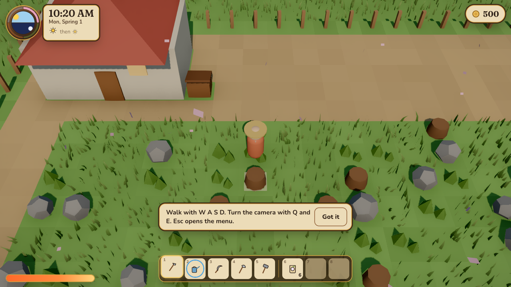
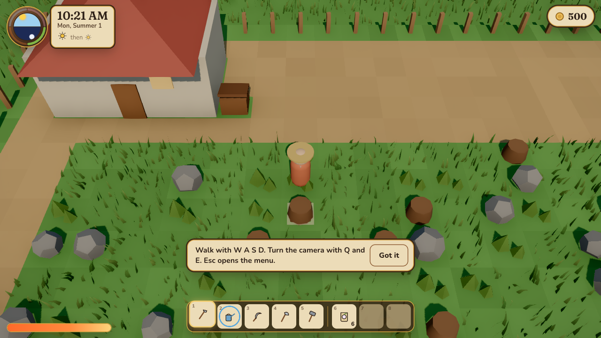
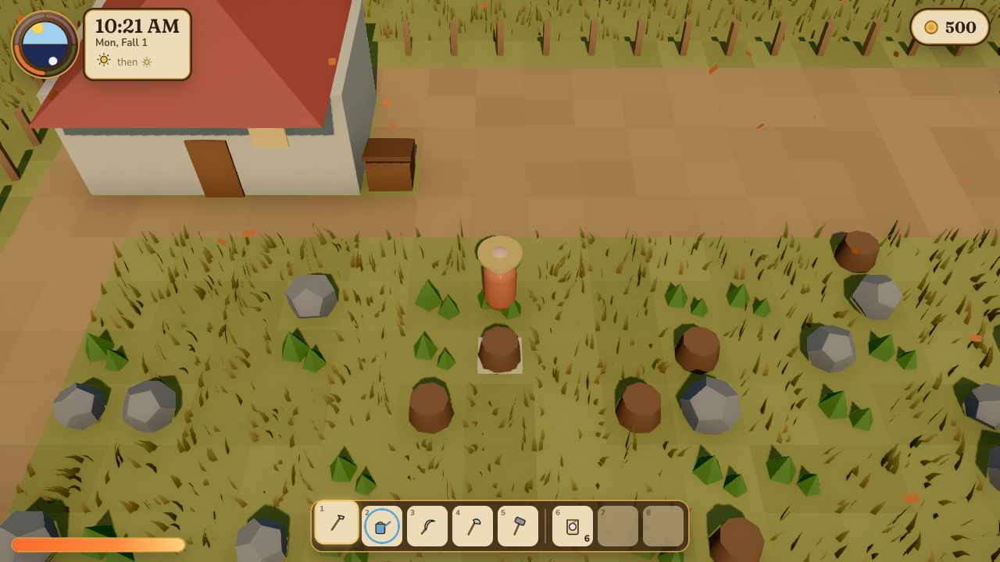
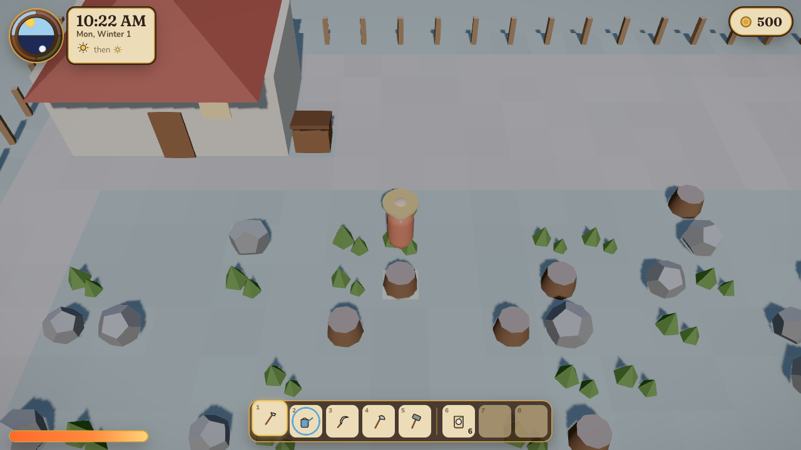

# Hearthvale

A cozy 3D farming-life game that runs in the browser, on desktop and on phones. Take over grandpa's
overgrown farm, clear the field, grow eight crops through four seasons, ship your harvest, and keep the farm
going through rain, storms and snow.

Hearthvale is an original game inspired by the classic farm-sim genre. Part 1 (this release) is the farm loop;
the town, festivals, romance and the valley's story follow in later parts (see
[the design spec](docs/superpowers/specs/2026-10-23-hearthvale-part1-design.md), Appendix A).

| Spring                           | Summer                           |
| -------------------------------- | -------------------------------- |
|  |  |
| **Fall**                         | **Winter**                       |
|      |  |

**Live:** _added after the first deploy_

## Play

| Action               | Keyboard                 | Gamepad                               | Touch                        |
| -------------------- | ------------------------ | ------------------------------------- | ---------------------------- |
| Walk                 | W A S D / arrows         | Left stick                            | Drag on the left side        |
| Run                  | Hold Shift while walking | Push the stick all the way, or hold B | Drag out to the glowing ring |
| Use tool             | Space                    | A                                     | ✦ button                     |
| Interact, plant, eat | F                        | X                                     | ✋ button                    |
| Pick a tool or item  | 1–8, mouse wheel         | LB / RB                               | ⇄ button, tap the hotbar     |
| Turn the camera      | Q / E                    | LT / RT                               | ⟲ ⟳ buttons                  |
| Zoom                 | + / −                    |                                       |                              |
| Menu                 | Esc / Tab                | Start                                 | ☰                           |

Sleep in your bed to end the day and save. Anything in the shipping bin sells overnight. Sol's cart on the
east road sells seeds from 9 AM to 5 PM, spring to fall.

New farms start with Grandpa's lessons. Reread them, skip them or start them again from the Journal
tab in the menu.

## Develop

Requires Node 24 and pnpm 10.

```bash
pnpm install
pnpm dev          # http://localhost:5173
pnpm test         # unit tests (core + web)
pnpm e2e          # Playwright: Chromium, WebKit, Pixel 7, iPhone 14
```

| Script                         | What it does                                                 |
| ------------------------------ | ------------------------------------------------------------ |
| `pnpm lint` / `pnpm typecheck` | ESLint (strict, type-checked) and TypeScript                 |
| `pnpm test:coverage`           | Unit tests; `packages/core` must stay at ≥ 90% coverage      |
| `pnpm build`                   | Production build into `apps/web/dist`                        |
| `pnpm --filter web size`       | Bundle budget: initial JS ≤ 500 KB gzipped                   |
| `pnpm --filter web perf`       | Load time on a throttled phone profile (production build)    |
| `pnpm checks`                  | All the checks above with live progress (pre-commit runs it) |

There is no GitHub CI: a Husky **pre-commit** hook runs every check on your machine before each
commit (~4 min). It fixes and lints the staged files, then runs `pnpm checks`: lint, typecheck,
unit tests with coverage, production build, debug-hook check, bundle size, and e2e on Chromium and
WebKit. The checks run on your working tree, so files you have not staged count too. It needs a
free port 5199 (stop any `pnpm dev:e2e` first). Skip once with `git commit --no-verify`.

Each step shows a spinner and its time, and prints its output only if it fails; e2e prints one live
line per test.

## How it's built

```
packages/core   Pure TypeScript rules: applyCommand(state, cmd) → { state, events }. Deterministic, no DOM.
apps/web        Vite + React 19 + React Three Fiber. Fixed 50 ms simulation step, DOM HUD over the canvas.
```

- **Rendering:** instanced tiles, wind-swayed grass and trees, a time-of-day sun and sky, shader snow cover,
  GPU rain and snow, a pond shader, and post-processing (ambient occlusion, bloom, AgX tone mapping, a
  seasonal colour grade). Quality adapts to the device and frame rate.
- **Saves:** IndexedDB with three slots and an automatic backup per slot, validated with zod and versioned for
  migrations. Export and import as a file.
- **Tested:** property-based invariants, a scripted bot that plays a full year, component tests, and
  Playwright end-to-end tests with axe accessibility checks.

More detail: [docs/ARCHITECTURE.md](docs/ARCHITECTURE.md). How AI agents work in this repo (rules, project memory, code map): [docs/agent-workflow.md](docs/agent-workflow.md). Asset credits: [CREDITS.md](CREDITS.md).

## Roadmap

1. **Farm loop** — this release
2. Town, villagers, friendship, cloud saves
3. Story: the Hearth Tree, Kindlings, festivals, romance
4. Animals, mining, fishing, upgrades
5. Phone app (Expo shell around the web game)
