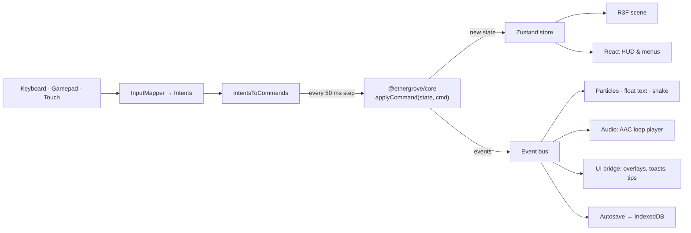

# Architecture

Ethergrove Chronicles is split into a pure rules engine and a web app that draws it.

## `packages/core` — the rules

- **Deterministic and pure.** `applyCommand(state, cmd) → { state, events }`. No DOM, React or three.js
  (enforced by ESLint). All randomness comes from a seeded mulberry32 stored in `state.rng`, so the same seed
  and commands always produce the same game.
- **Systems** (`src/systems/`): calendar, bag, movement (circle-vs-tile collision with substeps), tools and
  stamina, crops, weather, economy, end of day, interaction, milestones.
- **Overnight order** is fixed in `systems/day.ts` (sell bin → grow → date and season deaths → weather → water
  → stamina and gold). Tests pin it.
- **Saves** (`src/save/`): a zod schema validates every loaded file; `migrate()` upgrades old versions step by
  step; `SaveRepository` is the storage interface.

## `apps/web` — the game you see

- **Fixed-step loop** (`scene/GameLoop.tsx`, `game/loop.ts`): frames feed an accumulator; each 50 ms step reads
  input, dispatches commands and ticks the clock (10 game minutes per 7 real seconds). Frames longer than
  250 ms are clamped so a locked phone never fast-forwards the day.
- **Rendering** (`scene/`, `render/`): instanced tiles, grass and trees; shader patches for wind and snow; a
  time-of-day sun and sky; GPU rain and snow; post-processing (N8AO on the high tier, bloom, AgX, a seasonal
  grade). Quality tiers start from the device and drop automatically when the frame rate falls.
- **UI** (`ui/`): DOM over the canvas so text stays sharp and accessible. Menus share one parchment `Panel`
  with arrow-key and gamepad focus navigation.
- **Saves** (`save/`): IndexedDB with three slots and a backup of the previous good save per slot; autosave on
  each new morning and when the page is hidden; export and import as `.ethergrove.json` (old `.hearthvale.json` files still import).
- **Audio** (`audio/`): `install.ts` follows the store and event bus; `music.ts` picks one track per situation
  (title, season, rain, night, home, shop) and a jingle per event batch; `sound.ts` keeps the rules (silent until a
  gesture, deduped one-shots). `orchestraBackend.ts` drives `player.ts`, which streams the shipped `.m4a` files:
  1.2 s crossfades, at most 2 decoded tracks, jingles duck the music. The files are rendered offline by the
  dev-only **studio** (`src/studio/`, `studio.html`, `scripts/studio.mjs`) from scores and CC0 VSCO 2 samples;
  the game never imports the studio (a test checks it).
- **Resilience**: a WebGL fallback screen, GPU context-loss recovery, error boundaries, and a banner when
  storage is unavailable.

## Testing

| Layer                                                               | Tool                                                               |
| ------------------------------------------------------------------- | ------------------------------------------------------------------ |
| Rules, invariants, determinism, a scripted full year                | Vitest + fast-check (`packages/core`, ≥ 90% coverage)              |
| Store, loop, input, saves, HUD, menus                               | Vitest + Testing Library + fake-indexeddb                          |
| Real game in browsers (golden path, phones, a11y, visuals, seasons) | Playwright + axe                                                   |
| Load time on a throttled phone profile                              | Playwright against the production build (`pnpm --filter web perf`) |
