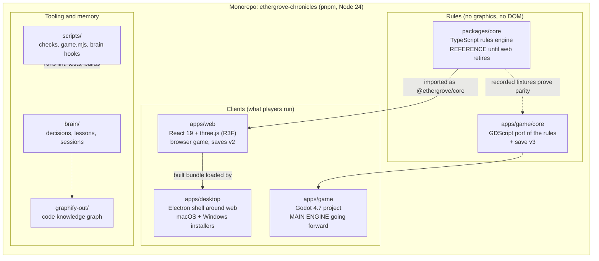
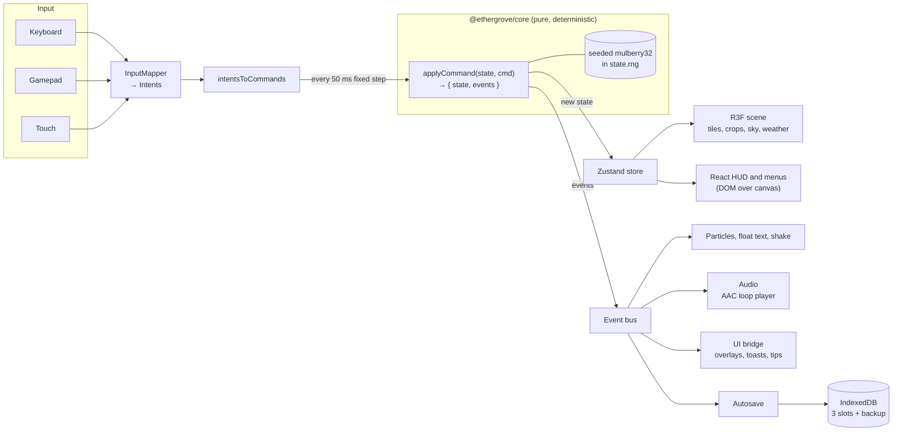
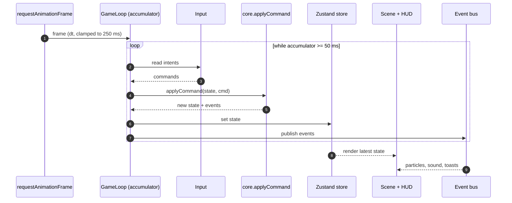
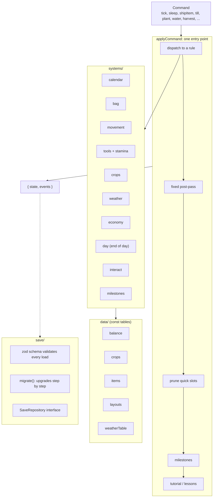
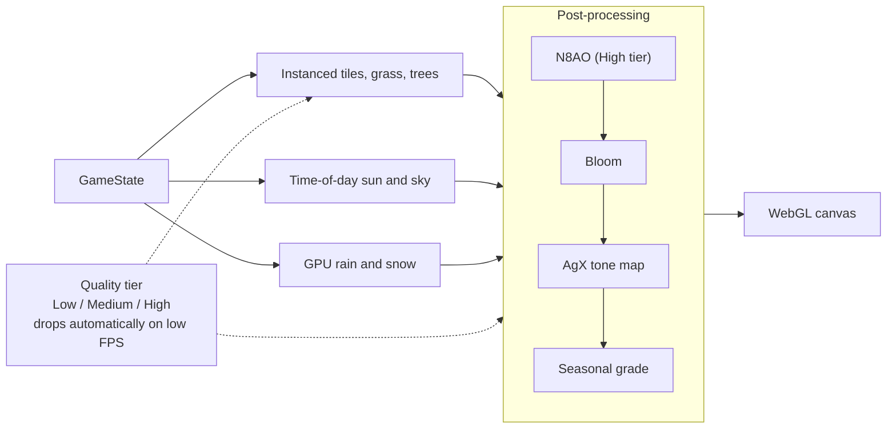
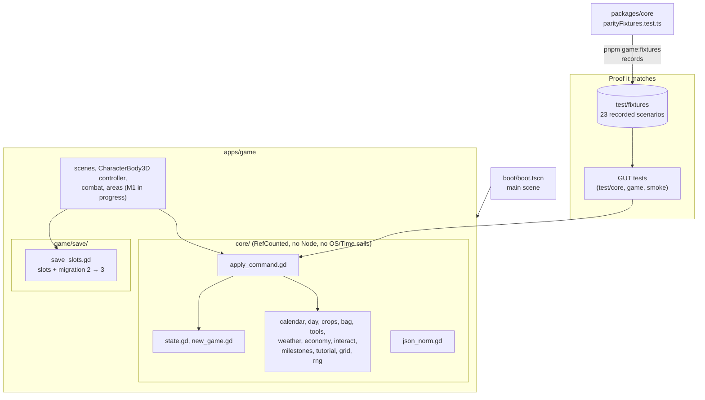
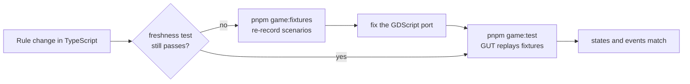
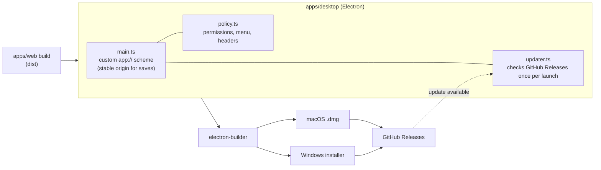
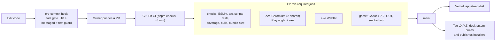
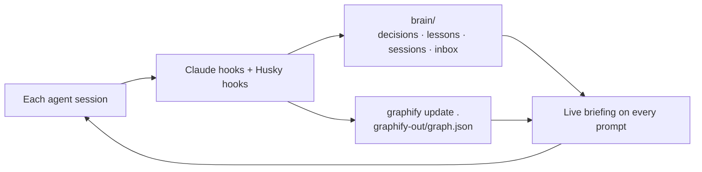

# Ethergrove Chronicles: Visual Architecture

A picture-first tour of how the game is built. The diagrams are [Mermaid](https://mermaid.js.org/), so GitHub and
most Markdown viewers draw them. For the written rules of each layer see [ARCHITECTURE.md](ARCHITECTURE.md) (the
web game) and the [M1 Godot spec](superpowers/specs/2026-11-03-m1-vertical-slice-design.md).

> **Status (2026-11-03):** the owner chose **Godot as the main engine** and dropped phones
> ([decision 0019](../brain/decisions/0019-godot-main-no-phones.md)). The web game (React + three.js) stays
> playable until Godot reaches parity, then it is retired. So the repo holds **two games sharing one set of
> rules**, for now.

## 1. The big picture

Everything is one pnpm monorepo. The rules live in a pure core; each app is a different way to draw and play them.

| Piece           | Tech                                        | Ships as                        | Future                     |
| --------------- | ------------------------------------------- | ------------------------------- | -------------------------- |
| `packages/core` | TypeScript, zod, Vitest, fast-check         | library used by the web game    | retired with the web game  |
| `apps/web`      | React 19, three.js, R3F, Zustand, IndexedDB | website on Vercel               | retired at Godot parity    |
| `apps/desktop`  | Electron, electron-updater                  | Mac and Windows installers      | wraps the web game for now |
| `apps/game`     | Godot 4.7, GDScript (typed), GUT tests      | desktop, desktop browser, Steam | **the main game**          |

## 2. Web game: the data flow

One direction, one rule: input becomes commands, commands go through the pure core, and everything else only
reads the result.

**Why it is built this way:** the core never touches the DOM, React or three.js (ESLint enforces it), and all
randomness is seeded. The same seed plus the same commands always produce the same game, which is what makes
the rules testable and portable to Godot.

## 3. Web game: one frame in time

Frames longer than 250 ms are clamped, so a locked device never fast-forwards the day. One game day is
10 game minutes per 7 real seconds.

## 4. Inside the rules engine

**Overnight order** (pinned by tests): sell bin → crops grow → date and season deaths → weather → water →
stamina and gold.

## 5. Rendering stack (web game)

## 6. Godot game (the main engine going forward)

The Godot project mirrors the TypeScript core as pure GDScript, then adds scenes on top.

Key Godot choices (from the [M1 spec](superpowers/specs/2026-11-03-m1-vertical-slice-design.md)):

- **GDScript only, fully typed.** C# is rejected because Godot 4 C# does not export to the web.
- **Renderer:** Forward+ on desktop at every tier; Compatibility for the web export.
- **Web export:** single-threaded, so no cross-origin isolation headers are needed.
- **No self-update code** in the Godot build.
- **Save v3 lives only in Godot.** Web saves (v2) come in through "Export save file" and migrate 2 → 3.

## 7. Keeping two cores honest (parity)

Until the web game is retired, every Part 1 rule change lands in **both** languages
([decision 0020](../brain/decisions/0020-godot-core-port-parity.md)).

## 8. Desktop app and release

The Godot build will replace this path (desktop exports and Steam). It contains no self-update code.

## 9. Quality gates and delivery

| Layer                                       | Tool                                           |
| ------------------------------------------- | ---------------------------------------------- |
| Rules, invariants, determinism, a full year | Vitest + fast-check (core coverage ≥ 90%)      |
| Store, loop, input, saves, HUD, menus       | Vitest + Testing Library + fake-indexeddb      |
| Real game in browsers                       | Playwright + axe                               |
| Load time on a throttled profile            | Playwright against the production build        |
| Godot rules and parity                      | GUT, headless (`pnpm game:test`, `game:smoke`) |

## 10. Project memory

## 11. Where things live

| I want to...                  | Look here                                                               |
| ----------------------------- | ----------------------------------------------------------------------- |
| Change a game rule            | `packages/core/src/systems/` **and** `apps/game/core/`                  |
| Change a number (price, rate) | `packages/core/src/data/balance.ts` and its GDScript twin               |
| Change how the web game looks | `apps/web/src/scene/`, `render/`, `ui/`                                 |
| Change controls               | `apps/web/src/input/`                                                   |
| Change saves                  | `packages/core/src/save/`, `apps/web/src/save/`, `apps/game/game/save/` |
| Change music or sound         | `apps/web/src/audio/`, `docs/audio/SOUNDTRACK.md`                       |
| Change the desktop shell      | `apps/desktop/src/`                                                     |
| Read why a decision was made  | `brain/decisions/`                                                      |
| Read the full designs         | `docs/superpowers/specs/`                                               |
