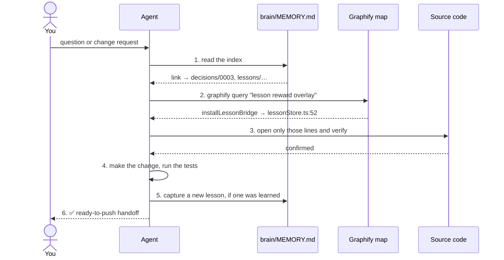
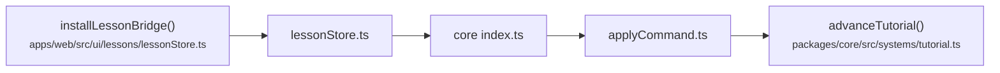
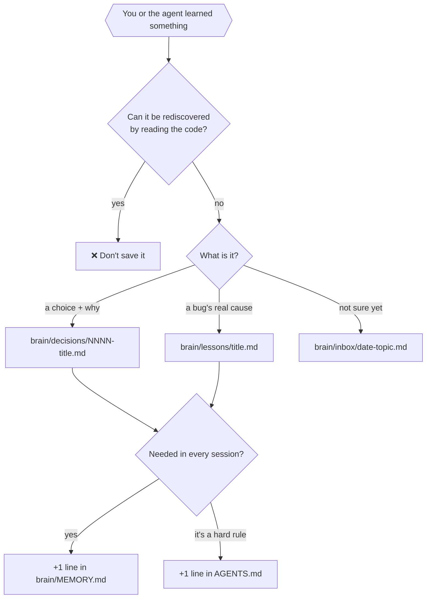
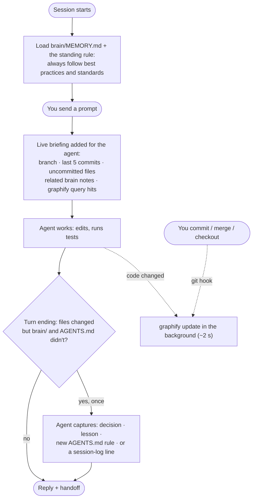
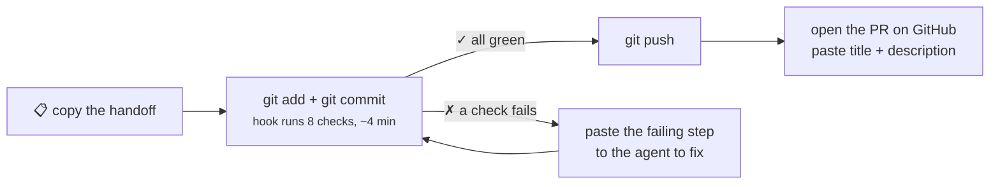

# The agent workflow: a quick tutorial

How AI coding agents (Claude Code, Codex, Cursor and others) work in this repo. They follow shared
rules, remember what the project learned, find their way around the code with a map, and hand you
finished work to push yourself.

Reading time: about 10 minutes.

## 1. The big picture

Four pieces work together:

```mermaid
flowchart TB
  you(["👤 You"]) -->|ask for a change| agent["🤖 Agent<br/>(Claude Code, Codex, …)"]

  subgraph rules["📜 Rules: how to work"]
    agents["AGENTS.md<br/>shared by every agent"]
    claude["CLAUDE.md<br/>loads AGENTS.md for Claude"]
  end

  subgraph memory["🧠 Memory: what we learned"]
    brain["brain/<br/>decisions · lessons · sessions"]
  end

  subgraph map["🗺️ Map: where the code is"]
    graph["graphify-out/<br/>code + notes graph"]
  end

  subgraph gate["🛡️ Gate: is it safe"]
    hook["pre-commit hook<br/>all 8 checks"]
  end

  agent --> rules
  agent --> memory
  agent --> map
  agent -->|"✅ ready-to-push handoff"| you
  you -->|"git commit"| hook
  hook -->|"all green"| push(["git push → PR"])
```

| Piece      | File or folder                 | One-line job                                              |
| ---------- | ------------------------------ | --------------------------------------------------------- |
| **Rules**  | `AGENTS.md` (+ `CLAUDE.md`)    | How agents behave here: commands, standards, the git rule |
| **Memory** | `brain/`                       | Decisions and lessons, so nobody re-learns them           |
| **Map**    | `graphify-out/` (generated)    | Answers "where is X / what calls Y" in one command        |
| **Skill**  | `.claude/skills/second-brain/` | Claude's step-by-step routine for using the memory        |
| **Gate**   | `.husky/pre-commit`            | Runs every check before a commit is allowed               |
| **Upkeep** | `scripts/brain/` + hooks       | Briefs every prompt, asks for captures, refreshes the map |
| **You**    | your terminal                  | The only one who commits on your own and pushes           |

## 2. Where everything lives

```text
hearthvale/
├── AGENTS.md                  ← 📜 the rules (edit this one)
├── CLAUDE.md                  ← tiny: "@AGENTS.md" + Claude-only notes
├── .graphifyignore            ← what the map should skip
│
├── brain/                     ← 🧠 project memory (committed to git)
│   ├── MEMORY.md              ←   START HERE: short index of key facts
│   ├── decisions/             ←   "we chose X because Y" (numbered)
│   ├── lessons/               ←   "this broke, here's the real cause"
│   ├── sessions/              ←   one log per work day
│   └── inbox/                 ←   quick notes waiting to be sorted
│
├── .claude/
│   ├── settings.json          ← hooks: prompt briefing, capture prompt, map nudges
│   └── skills/
│       ├── second-brain/      ← 🧠 routine: recall · capture · close · review · audit
│       └── graphify/          ← 🗺️ Graphify's own skill (installed, don't edit)
│
├── scripts/brain/             ← 🔁 the automation behind those hooks (+ tests)
├── .husky/post-commit         ← refreshes the map after commits (also post-merge, post-checkout)
│
├── graphify-out/              ← 🗺️ generated map (gitignored, rebuilt in ~4 s)
│   ├── GRAPH_REPORT.md
│   ├── graph.json
│   └── graph.html             ←   open in a browser to explore visually
│
└── docs/                      ← human docs (this file, architecture, specs)
```

> **Rules vs memory vs docs.** `AGENTS.md` says _how to work_. `brain/` says _what happened and why_.
> `docs/` explains the product to humans. Each fact lives in one place; the others link to it.

## 3. How one task flows

Say you ask: _"Why does the lesson card wait before showing the reward?"_



The agent **remembers** (brain), **finds** (graph), **checks** (code), **works**, **records**, then **hands it
to you**.

## 4. The map in action (real output from this repo)

```bash
$ graphify explain "advanceTutorial"
Node: advanceTutorial()
  Source:    packages/core/src/systems/tutorial.ts L176
  <-- applyCommand() [calls]            packages/core/src/applyCommand.ts:L56
  --> adapt()        [calls]            packages/core/src/systems/tutorial.ts:L198
  --> isDone()       [calls]            packages/core/src/systems/tutorial.ts:L188
  <-- Task 2: Lesson progression…       docs/superpowers/plans/…tutorial.md:L123
```

```bash
$ graphify path "installLessonBridge" "advanceTutorial"
installLessonBridge() → lessonStore.ts → index.ts → applyCommand.ts → advanceTutorial()
```

One command shows a function's callers, what it calls, and the docs that mention it. That saves a dozen
searches.



> The map is a **guide, not the truth**. Agents always open the real lines before acting.

## 5. The memory: what goes where



Every note:

- cites **evidence** (a file path, commit or test)
- is tagged **verified** (checked) or **inferred** (reasoned, not yet checked)
- never contains secrets or personal data, because the notes are committed

Example: [brain/lessons/lesson-marker-render-loop.md](../brain/lessons/lesson-marker-render-loop.md) records
what broke, the proven cause, the fix, and the one-line rule.

## 6. Using it with Claude Code

Type these in Claude Code. Plain English works too, e.g. "capture this as a lesson".

| You type                 | What happens                                                          |
| ------------------------ | --------------------------------------------------------------------- |
| `/second-brain recall …` | Answers from `brain/`, then verifies against the code                 |
| `/second-brain capture`  | Saves a decision or lesson (updates an existing note if one exists)   |
| `/second-brain close`    | Writes today's session log and refreshes the map                      |
| `/second-brain review`   | Empties the inbox, merges duplicates, marks old notes superseded      |
| `/second-brain audit`    | Checks links, evidence, verified tags, and that no secrets slipped in |
| `/graphify .`            | Full rebuild, including AI reading of docs (uses tokens)              |

Other agents (Codex, Cursor and so on) don't have the skill, but `AGENTS.md` gives them the same rules.

## 6b. It runs itself: automatic upkeep

You don't have to ask for any of this; hooks do it ([decision 0006](../brain/decisions/0006-automated-second-brain.md)).



| When                        | What happens automatically                                        |
| --------------------------- | ----------------------------------------------------------------- |
| Session starts              | Memory index and standing rule loaded; stale map rebuilt          |
| Every prompt                | Briefing on what changed, related notes, code-map starting points |
| A turn changed files        | One capture pass so the lesson lands in `brain/` or `AGENTS.md`   |
| Code changed, or you commit | Map refreshed in the background                                   |

Prompts themselves are never saved: notes are committed, so only the distilled lesson is kept.

## 7. The finish line: you push, not the agent

Agents **never push** and only commit when you ask. When work is done, the last message is a handoff
you can paste:

````markdown
✅ Ready to push: branch `feat/tutorial` (6 changed files, checks: all 8 passed)

Commit:

```bash
git add brain/ AGENTS.md docs/agent-workflow.md
git commit -m "docs(brain): add project memory and Graphify map" -m "Why and what, in 1–3 lines."
```

Push:

```bash
git push -u origin feat/tutorial
```

PR title: docs: project memory and code map for agents

PR description: (ready-made markdown with What / Why / How it was checked)
````

Then you:



## 8. Cheat sheet

```bash
graphify update .                       # refresh the map after changes (~4 s, offline)
graphify query "how do saves migrate"   # ask the map a question
graphify explain "migrate"              # one symbol: callers, callees, docs
graphify path "Hotbar" "lessonSlot"     # how two things connect
open graphify-out/graph.html            # explore the map visually
pnpm checks                             # run every check by hand (same as the hook)
```

## 9. Troubleshooting

| Problem                               | Fix                                                                                                                                                                                                     |
| ------------------------------------- | ------------------------------------------------------------------------------------------------------------------------------------------------------------------------------------------------------- |
| `graphify: command not found`         | Install it: `python3 -m venv ~/.local/share/graphify/venv && ~/.local/share/graphify/venv/bin/pip install graphifyy`, then `ln -s ~/.local/share/graphify/venv/bin/graphify /opt/homebrew/bin/graphify` |
| Map answers look out of date          | `graphify update .` (the report header shows which commit it was built from)                                                                                                                            |
| An agent says "pushed" or opened a PR | That breaks the rule in `AGENTS.md`. Tell it to stop, and check `git log origin/<branch>`                                                                                                               |
| Commit seems stuck                    | The hook runs e2e tests for about 4 min. Make sure nothing else is using port 5199                                                                                                                      |
| A note contradicts the code           | The code wins. Run `/second-brain review` to mark the note superseded                                                                                                                                   |

## 10. Setting this up in another project

1. Copy `AGENTS.md` (keep the Working standard, Git and Project memory sections; replace the rest) and the
   three-line `CLAUDE.md`.
2. Copy `.claude/skills/second-brain/` and create `brain/MEMORY.md` with that project's facts.
3. In that project: `graphify install --platform claude --project`, then `graphify update .`.
4. Add `graphify-out/` to `.gitignore`, and write a `.graphifyignore` for that project's assets.
